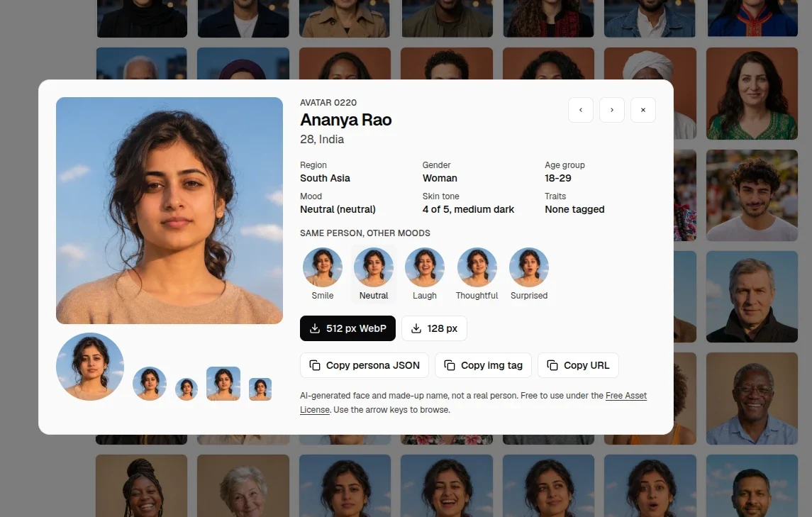

# Personified

<p align="center"></p>

315 free AI avatar photos with ready personas, by [All SVG Icons](https://allsvgicons.com/personified-free-avatars/). Each face comes with a name, country, region, age, gender, skin tone and mood, so mockups, demo data and placeholder users look real without using real people.

None of these people exist. See the license for what that means for your use.

<p align="center"><a href="https://allsvgicons.com/personified-free-avatars/"></a></p>

## Install

```sh
npm i personified
```

## Use

```js
import { avatars, find, pick, file } from 'personified';

const people = find({ region: 'South Asia', band: '30-44', skin: [3, 5] });
const src = file(people[0].id, 256); // file: URL in Node, asset URL in Vite and other bundlers

// Same face for the same user, every time (email, user id, name)
const me = pick('amit@example.com', { band: '30-44' });
```

Fully typed: every option value (countries, moods, hair colors, ids) is a literal type, so editors suggest valid values and typos fail type checks.

Or import a file directly: `personified/img/256/0001.webp`. Plain data: `personified/index.json`.

| Option | Values |
|---|---|
| `region` | Africa, Americas, Central Asia, East Asia, Europe, Middle East, Oceania, South Asia, Southeast Asia |
| `country` | country name, for example `India`, `Brazil` |
| `gender` | `w`, `m`, `x` |
| `band` | `18-29`, `30-44`, `45-59`, `60+` |
| `mood` | smile, laugh, wink, surprised, neutral, thoughtful |
| `skin` | 1 (light) to 5 (dark), or a `[min, max]` range |
| `hair` | any of `{ color, length, style }`, for example `{ color: 'grey', style: 'curly' }` |
| `backdrop` | plain-light, plain-dark, color, outdoor, indoor |
| `trait` | for example beard, stubble, glasses, jewelry, hijab, freckles |
| `person` | the id of one face: returns all moods of that person |

## Files

`img/512/`, `img/256/` and `img/128/`, WebP, square, named by id (`0001.webp`). Ids are permanent: new avatars get new ids, existing ids and file names never change.

## For AI coding agents

[llms.txt](llms.txt) has the API, valid values, recipes and license rules written for agents.

## License

Code (`index.js`, `index.d.ts`) is [MIT](LICENSE-MIT). Images and data (`img/`, `index.json`) use the Free Asset License: 
Free for personal and commercial use, no credit needed. You may not resell or redistribute the files themselves, or use them to build a competing asset library, and you may not present the faces as real people (fake reviews, fake staff, fake profiles). Full terms: [LICENSE.md](LICENSE.md).

Browse all faces: https://allsvgicons.com/personified-free-avatars/

## Contributing

Issues and pull requests for the code are welcome. New faces come from the All SVG Icons team. See [CODE_OF_CONDUCT.md](CODE_OF_CONDUCT.md).
